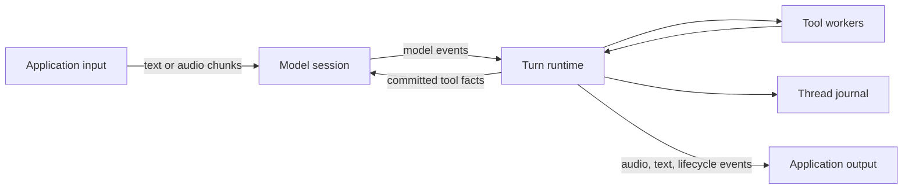

# Bidirectional Model Sessions

Canary has one turn runtime with two model interaction paths. Request-based
clients use `stream_complete`; bidirectional clients open a persistent session.
Both share the journal, tool execution, hooks, limits, cancellation, recovery,
and explicit `end_turn()` completion.



## Adapter Contract

Implement `ModelClient::interaction()` with `ModelInteraction::Bidirectional`
and implement `connect(ModelSessionConfig)`. Return a `ModelSession` with
independently owned `ModelSessionSender` and `ModelSessionReceiver` halves.
The runtime drives sending and receiving concurrently, so a blocked send does
not prevent output reception or cancellation.

The adapter owns provider framing, audio-format compatibility, function-argument
assembly, and configured server-side turn detection and interruption. It emits
`ItemCompleted` when an item's text and arguments are complete. IDs identify
responses and input/output items within one connection. Transcription reports
input already consumed, not fresh input for another inference.

`ModelSessionConfig.request` contains selected context and tool schemas.
`history` supplies durable facts for provider-specific restoration, including
outstanding operations. These are two views of the same history, not two inputs
to submit independently. Reopening must not execute tools or replay old audio.

`Observe` delivers committed tool lifecycle facts. The adapter maps these into
native results or observations. `ToolAccepted` means admission, not successful
completion; an adapter may wait for `ToolCompleted` to answer a native function
call. The bidirectional transport does not require Chat Completions envelopes.

The core supplies the contracts and execution engine, tested with a controlled
bidirectional adapter. A provider WebSocket/WebRTC adapter and microphone/playback
application remain separate integrations.

## Application Contract

Build an `Agent` with a bidirectional model client and call `open_stream_turn`.
After `TurnEvent::SessionReady`, feed the ongoing stream through a cloned handle:

```rust,ignore
let mut turn = agent
    .open_stream_turn("conversation", metadata, TurnConfig::default())
    .await?;
let handle = turn.handle();

// In the application's input task, after SessionReady:
handle.send_input(ModelInput::Audio { chunk }).await?;
// Subsequent chunks and later utterances use the same handle and connection.

// In its output task:
while let Ok(event) = turn.next_event().await {
    // Forward Session/AudioDelta to application playback.
    // Handle Suspended, and stop when Finished arrives.
}
let outcome = turn.wait().await?;
```

Capture, playback, echo control, and playback buffering belong to the host.
`cancel_response` requests provider-side interruption; `cancel_operation`
addresses a tool; `abort` stops the turn. Server-side speech interruption does
not implicitly cancel tools.

`send_input` acknowledges local queueing, not provider consumption, and applies
backpressure through its bounded queue. `append_input` acknowledges a journal
append; for a bidirectional client it does not submit the text to the service.
Provider transcripts are appended with connection/item identities without
triggering another request. Do not submit the same speech as both audio and text.

Subscribers receive explicit `Lagged` errors if they fall behind. Durable
history can be reloaded, but audio deltas cannot: the host must consume output
promptly or implement its own media handling.

## Lifecycle And Recovery

Provider response starts consume `max_model_iterations`. Function calls consume
the shared `max_function_calls` budget. Audio chunks and transcripts do not
create iterations. Usage events carry response and unique event IDs; adapters
convert provider counters to deltas.

`end_turn()` is checked against current runtime state: active operations,
known unfinished input, and stale response context prevent closure. Accepted
closure seals public input while allowing final audio, transcripts, and usage
through the closing response's `ResponseFinished`. Response completion alone
never completes the turn. Adapters must report interruption before subsequent
stale output items; late calls and deltas from finished responses are ignored.

Connection establishment failure, send/receive failure, and EOF suspend the
turn with `SuspensionKind::ModelConnection`. Tools continue and their outcomes
remain durable. Failure to enqueue a committed model observation also suspends
instead of silently dropping it.

`reconnect_model()` schedules another connection attempt; `SessionReady` confirms
opening. The adapter receives durable history, and tool results produced during
connection establishment are forwarded afterward. No microphone replay or
uncertain external-effect retry is automatic. After process loss,
`recover_turn()` applies existing tool recovery rules and opens a new session.
