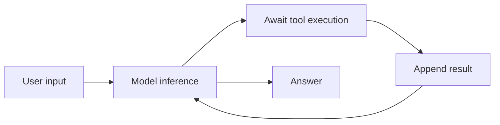
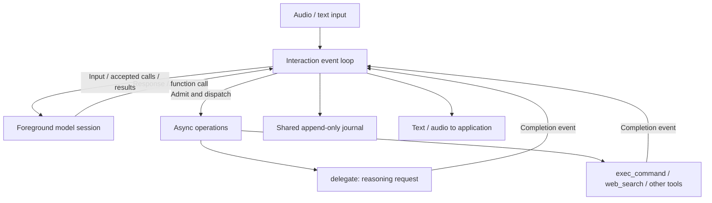
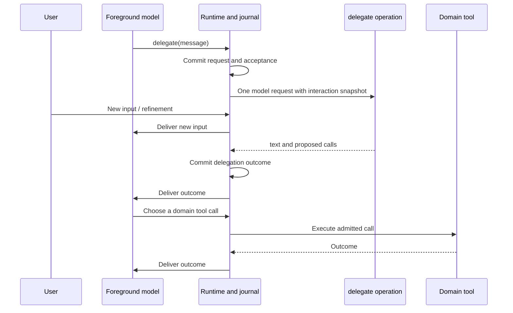

# Voice Agent Architecture

Canary's voice example is **one event-driven interaction with concurrent
operations**, not a voice agent forwarding tasks to an independently running
worker agent.

Two choices define the design:

1. **Decouple reasoning and tool execution.** Long-running work executes in async
   tasks; the interaction loop remains available for input and other results.
2. **Make reasoning delegation a function call.** A reasoning model advises the
   foreground model using the same interaction history, without creating a
   second autonomous conversation or tool loop.

The `voice` binary exposes domain tools directly. The `live` binary, or `--live`,
adds the `delegate` tool for more demanding reasoning. Delegation is optional;
ordinary tools do not have to pass through it.

## From Serialized ReAct To An Event Loop

A conventional serialized ReAct implementation runs this cycle:



In that implementation, awaiting a tool result is the gate to the next model
step. A slow command or reasoning request can hold up the interaction. This is
a property of the serialized implementation, not a restriction of ReAct itself.

Canary instead separates **dispatching work** from **waiting for its outcome**:



The loop admits a function call, durably records acceptance and start, then
launches its execution task. The task later reports its outcome through an
event channel. Acceptance is not completion, and a spoken promise is neither.

While an operation is pending, the foreground interaction can receive new input,
speak, start another operation, or request cancellation. Results may arrive in
a different order from their requests.

For example:

| Time | Event                                       | Runtime behavior |
| --- |---------------------------------------------| --- |
| t0 | User asks for a project architecture report | Foreground model requests `delegate` |
| t1 | Delegation starts                           | Reasoning runs outside the loop |
| t2 | User adds "focus on cancellation path"      | Input enters the same interaction while delegation is pending |
| t3 | Delegation returns proposals                | Result is appended and delivered to the foreground model |
| t4 | Foreground model requests a command         | Command executes outside the loop |
| t5 | Command finishes                            | Result returns as another event; the model decides the next step |

There is still causal ordering: a command that needs a reasoning result cannot
use that result before it exists. Concurrency permits overlap where dependencies
allow it; it does not remove dependencies or guarantee that every model response
will choose useful work.

## Why The Async-I/O Analogy Fits

The interaction loop resembles an async-I/O reactor:

| Async-I/O concept | Canary counterpart |
| --- | --- |
| Incoming event | User input, model output, operation outcome, cancellation |
| Dispatch I/O | Admit and launch an operation |
| In-flight request | Active operation identified by `operation_id` |
| Completion notification | Worker event reporting an operation outcome |
| Event handler | Update durable facts, project context, and notify the model |

The important similarity is **submit now, handle completion later**. The loop
does not wait inline for an entire reasoning or tool operation before handling
the next event.

This is an analogy, not an implementation claim: the runner uses Tokio tasks,
channels, and `select!`, not direct `epoll` calls. `epoll` commonly reports
readiness, whereas an operation event here reports an outcome. CPU-heavy or
blocking tool implementations must still use appropriate execution facilities;
an `async` function alone does not make blocking code nonblocking.

The loop remains the coordinator of journal updates and operation lifecycle.
Tool bodies run outside its event handler, but still belong to the same logical
interaction. Persistence and bookkeeping can themselves await; this is not a
hard-real-time or completely wait-free loop.

## Delegation Is A Tool, Not Another Agent



The delegation input is:

```json
{"message": "Inspect the cancellation design and propose the next commands."}
```

The output has this shape:

```json
{
  "text": "Inspect the runtime cancellation path first.",
  "proposals": [
    {
      "name": "exec_command",
      "arguments": {"cmd": "rg -n cancellation canary-agent-runtime/src"}
    }
  ]
}
```

Proposals are data, **not executed calls**. The reasoner receives domain tool
schemas, but the delegation implementation never dispatches those tools. It
returns its first model response as advice and proposals. The foreground model
can accept, change, ignore, or request further reasoning about them.

### One Authoritative History, Not Identical Model Contexts

An independent worker agent would maintain its own evolving conversation.
User refinements, tool results, and cancellation would need synchronization
between two histories.

Here, `delegate` receives the `FunctionContext` projection when its operation is
launched. It serializes that conversation as a labeled historical snapshot for
one reasoning request. The reasoner has its own advisory instructions, but no
separate persistent agent thread or autonomous multi-step tool loop.

Its outcome returns to the original interaction as an ordinary tool result.
This avoids **independently evolving conversation histories**, not all forms of
staleness: input arriving after dispatch is absent from the reasoner's snapshot.
The foreground model receives that newer input and the eventual result and
decides whether the advice remains useful. New input does not automatically
cancel an operation or make its result semantically obsolete.

The transcript representation also avoids replaying an unfinished foreground
tool-call exchange as native protocol messages to another model provider.

## Voice And Provider Boundaries

- **Rust application:** microphone capture, AEC, playback, playback accounting,
  local commands, and domain tool implementations.
- **Canary runtime:** interaction lifecycle, journal, projections, operation
  admission, async dispatch, cancellation, and result delivery.
- **Python provider adapter:** realtime connection, provider event translation,
  audio transport, and provider-specific tool/result mapping where implemented.
- **Realtime service:** continuous model session and provider-specific speech
  boundaries, generation, and interruption behavior.

Playback is separate from generation. Replacing speech clears local queued
audio; generating a chunk does not establish that it was played. Playback
feedback uses device timing estimates and remains tied to its original
connection. It does not prove that a person heard the sound.

Current adapter support is deliberately distinguished from the architecture:

| Capability | Qwen adapter | MOSS adapter |
| --- | --- | --- |
| Continuous audio input/output | Implemented | Implemented |
| Canary custom tools and result feedback | Implemented | Not implemented; public contract not established |
| Typed input | Implemented | Not implemented |
| Playback feedback | Accepted as a no-op | Chunk, completion, and stop acknowledgments |

MOSS's advertised tool capabilities do not establish a public registration
contract for Canary tools. The current MOSS demo cannot perform project
inspection through `exec_command` or reasoning through `delegate`. Startup
reports this limitation; live mode requires a tool-capable adapter. Offline
tests are not a guarantee of live-provider behavior.

## Lifecycle And Limits

`call_id` identifies a model's function request; `operation_id` identifies the
runtime operation used for tracking and cancellation. Both domain tools and
reasoning delegation participate in the same operation mechanism.

Cancellation is a request, not proof that an external side effect was undone.
The runtime signals the operation; implementations must propagate cancellation
to their subprocesses or remote work. An unresolved outcome can remain
indeterminate. Async dispatch does not provide exactly-once external execution.

A text answer does not close the interaction. The model explicitly requests
`end_turn`; closure is rejected while active operations or other outstanding
conditions prevent it. Caller abort and connection suspension are distinct from
normal completion.

## Code Map

- [Application and audio event handling](../src/main.rs)
- [Single-request reasoning delegation](../src/live.rs)
- [Provider-neutral Rust IPC client](../src/model_bridge.rs)
- [Audio processing and playback](../src/audio.rs)
- [Playback feedback accounting](../src/feedback.rs)
- [Qwen adapter](../python/worker.py) and [MOSS adapter](../python/moss_bridge.py)
- [Runtime coordinator](../../../canary-agent-runtime/src/turn/runner.rs)
- [Inference and function execution tasks](../../../canary-agent-runtime/src/turn/worker.rs)
